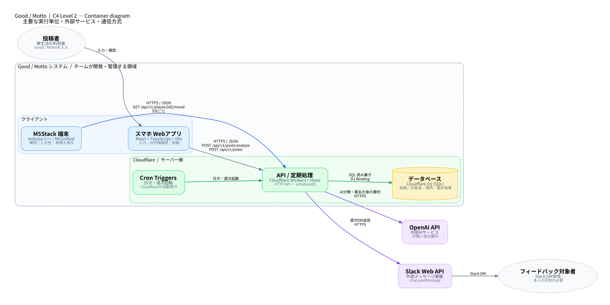
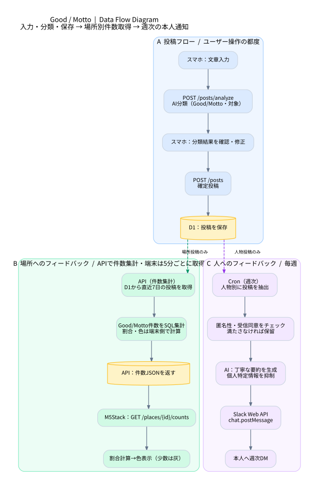
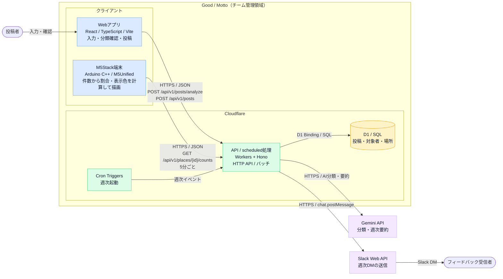
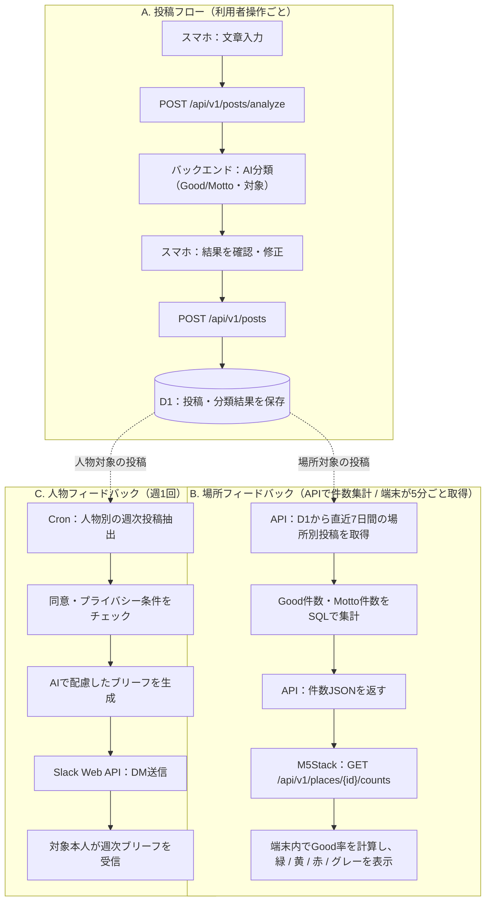

# Good / Motto システム構成図（設計案 v1）

作成日: 2026-11-04
設計基準: C4 Model（Container diagram / Dynamic diagram） + データフロー図
状態: 提案・未実装。技術スタックは現時点の候補として記述。Gemini無料枠は使用量制限があり、送信内容がサービス改善に利用され得るため、個人の不満等の送信には同意とデータ最小化が必要。

## システム構成図（SVG）

### C4 Container図

### データフロー図

## 0. 図の読み方

- 青: スマホ・M5Stackのクライアント
- 緑: チームのサーバー側（Cloudflare Workers）
- 黄: データベース（D1）
- 紫: 外部API・外部サービス（Gemini / Slack）
- 矢印: ラベルの方向に通信または処理を依頼する（C4の表記法）
- 点線: 投稿から場所別集計・週次処理への論理的なデータ引き渡し
- C4における **Container** は Docker コンテナのことではなく、独立して実行されるアプリケーションやデータストアを意味する。

## 1. C4 Level 2 — Container diagram

- `Webアプリ` は利用者のスマホのブラウザ上で動く。静的ファイルは Cloudflare Workers Static Assets から配信する設計。
- `API / scheduled処理` は同じ Workers プロジェクトで実装可能。Cron は WebからのHTTPとは別のイベントで発火。
- `M5Stack` が自ら5分に1回、Good/Mottoの件数を問い合わせる（ポーリング）。サーバー側から M5Stack に直接通信を始めるのではない。
- `Gemini API` と `Slack Web API` は管理対象外の外部サービス。トークンはサーバー側にだけ保持。

## 2. Dynamic / Data Flow diagram

## 3. API契約（4人で共有するインターフェース）

詳細なRequest / Response仕様: [API契約 v1](../api/contract-v1.md)

| HTTPメソッドとパス | 呼び出し元 | 主なリクエスト | 主なレスポンス |
| --- | --- | --- | --- |
| `POST /api/v1/posts/analyze` | スマホ | `text` | `sentiment`, `target_type`, `target_id`, `target_label` |
| `POST /api/v1/posts` | スマホ | `text`, `sentiment`, `target_type`, `target_id` | `post_id`, `status` |
| `GET /api/v1/places` | スマホ | なし | `places[]` |
| `GET /api/v1/people?query=...` | スマホ | 検索文字列 | `people[]` |
| `GET /api/v1/places/{id}/counts` | M5Stack | 場所ID（URL） | `place_id`, `period_days`, `good_count`, `motto_count`, `updated_at` |

人物検索・本人確認・認証の方式は [Slack OIDC認証設計](../auth/slack-oidc-v1.md) に確定した（実装は未完了）。人を対象とする場合、AIが名前を抽出するだけでは本人と確定できないので、投稿前に対象者をユーザーが確認する。

## 4. 実装と責任範囲

| 担当 | コンポーネント | 実装内容 |
| --- | --- | --- |
| スマホ担当 | React SPA | 投稿フォーム、AI分析結果の確認・修正、POST呼び出し |
| バックエンド担当 | Workers / Hono / D1 / 外部API | すべてのAPI、AI連携、DB、場所別件数集計API、週次Slack DM、権限確認 |
| M5Stack担当 | Arduino / M5Unified | Wi-Fi接続、5分ごとの件数GET、割合計算、色と表情の描画、通信失敗時の表示 |
| Slack通知担当 | Workers Cron / Gemini API / Slack Web API | 週次の人物別投稿抽出、匿名性確認、Gemini要約、本人へのDM送信・重複防止 |

## 5. 未確定事項・運用時の安全要件

1. **認証**：投稿者はSlack OpenID Connect（[実装仕様](../auth/slack-oidc-v1.md)）。M5Stack用の読み取り専用資格情報は別途実装する。
2. **人物マスタ**：内部UUIDとSlackワークスペースID＋SlackユーザーIDをD1で一意に紐づける。
3. **AI送信内容**：氏名等を含む原文を外部LLMへ送る場合、十分な説明・同意とデータ最小化を実施する。
4. **プライバシー**：人物へのDMは本人同意と独立した投稿者数・特定可能性を確認。閾値を満たさない場合は通知しない。少人数でも匿名性の保証はできない。
5. **場所表示**：投稿が少ない場合はグレー。件数や具体的内容を不必要に公開しない。
6. **タイミング**：Cron Triggers はUTC。週次DMは暫定で毎週月曜日09:00 JST（00:00 UTC）とする。
7. **例外処理**：APIエラー、Wi-Fi切断、AI分類失敗、Slack通知失敗時の再試行・表示を決める。
8. **デバイス機種**：M5Stackの型番は未確定。表示処理は実機決定後に調整。

## 6. 参考資料

- C4 Model公式: https://c4model.com/
- C4 Container diagram: https://c4model.com/diagrams/container
- C4 Dynamic diagram: https://c4model.com/diagrams/dynamic
- C4 Notation: https://c4model.com/diagrams/notation
- Zenn「システム構成図の書き方」: https://zenn.dev/maman/articles/a797a98ac548e9
- Cloudflare: https://developers.cloudflare.com/workers/vite-plugin/tutorial/
- Cloudflare D1: https://developers.cloudflare.com/d1/worker-api/
- Cloudflare Cron: https://developers.cloudflare.com/workers/configuration/cron-triggers/
- Gemini API（無料枠とプライバシーの注意）: https://ai.google.dev/gemini-api/docs/pricing